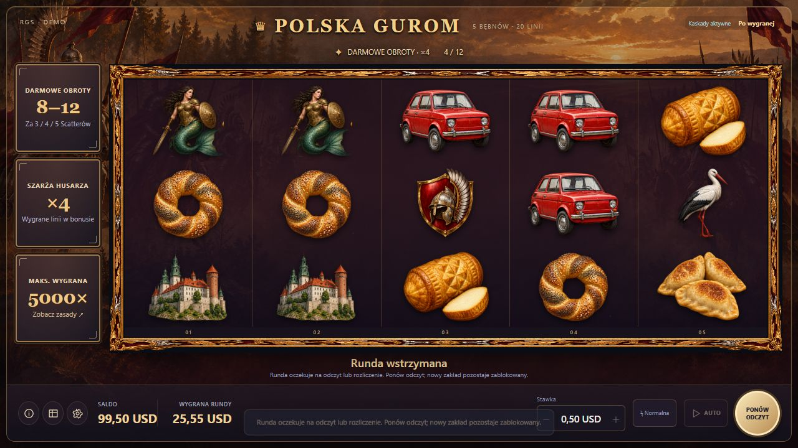
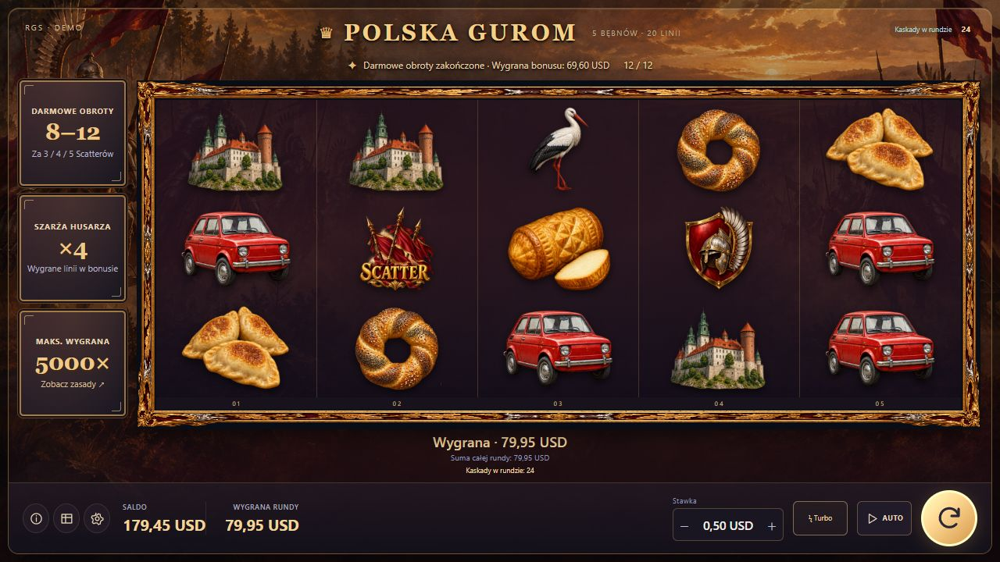

# POLSKA GUROM — odzyskiwanie rund po awarii połączenia

Data: 22.10.2026. **Zakończono implementację i weryfikację lokalną. Nie wykonano odbioru na prawdziwym Stake Engine — użytkownik potwierdził brak dostępu.**

## Zachowanie po zmianach

- Po bazie i każdym ukończonym darmowym obrocie zapisywany jest postęp przez `/bet/event`. Znacznik jest przypisany do konkretnego betID oraz wersji matematyki. Nie rozstrzyga wypłaty i nie pobiera stawki.
- Authenticate odczytuje znacznik. Ta sama karta i nowa karta bez poprzedniej pamięci mogą wznowić bonus od następnego ukończonego etapu, np. od piątego obrotu po 4/12. Niepełny obrót może zostać odtworzony od początku.
- Przy utracie odpowiedzi play klient zachowuje pierwotny zamiar. Odczytuje stan zamiast automatycznie wysyłać drugi zakład. Brak identyfikowalnego wyniku pozostawia blokadę.
- Utracone potwierdzenie wypłaty jest sprawdzane przed kolejnym end-round. Druga operacja checkpoint/finish w jednym kliencie jest blokowana. Inny betID lub zmieniona treść aktywnego wyniku uniemożliwiają rozliczenie starego zapisu.
- Błąd zapisu postępu zatrzymuje bonus i AUTO. Wstrzymana runda pokazuje rzeczywiście ukończony etap i dotychczas pokazaną wygraną; nie jest dopisywana do historii ukończonych rund.
- Przycisk POŁĄCZ PONOWNIE pozwala odtworzyć sesję po nieudanym uruchomieniu bez powielania obsługi kliknięć i bębnów. Wstrzymaną rundę można odświeżyć i ponowić jej odczyt.
- Wcześniej opłacony bonus zachowuje swoją stawkę nawet po zmianie dozwolonych poziomów przez platformę. Nowa dozwolona stawka obowiązuje po jego rozliczeniu.

## Sprawdzenie

| Zakres | Wynik |
|---|---:|
| Testy Python, w tym rzeczywiste lokalne połączenia HTTP | 64/64 |
| Testy JavaScript, w tym zgodność z równoległymi zmianami replay i walut | 261/261 |
| Łącznie, 16 zestawów | **325/325** |
| Nowe testy logiki odzyskiwania | 33/33 |
| Nowe testy HTTP odzyskiwania | 6/6 |
| Kontrole utrwalonych źródeł i finalnych ZIP, wykonane bez sieci | 115/115 |
| Zmiany silnika, banku i wag | **brak — porównanie skrótów** |
| Rzeczywisty Stake / sesja operatora / ACP | **niewykonane** |

Nowe testy są częścią sumy 325, nie dodatkiem do niej. Poprzednie dokładne RTP 96% pozostaje parametrem niezmienionej matematyki; w tym etapie nie przebudowywano rozkładu.

HTTP sprawdzono niezależnie od testów z przyspieszonym zegarem. Symulator rzeczywiście zrywa połączenie przed wykonaniem żądania albo po zapisaniu znacznika / zaksięgowaniu wypłaty. W próbach kontrolowano jedno obciążenie i jedną wypłatę, również po odtworzeniu klienta.

W przeglądarce wykonano scenariusz bonusu 12 FS z utratą odpowiedzi po zapisie czwartego obrotu: zatrzymanie na 4/12, nowa karta bez poprzedniej pamięci, rzeczywiste odświeżenie, odczyt tego samego postępu i ukończenie 12/12. Lokalny dziennik potwierdził **1 zakład i 1 wypłatę**. Saldo: **100,00 − 0,50 + 79,95 = 179,45 USD**; po czwartym FS pokazana wygrana wynosiła 25,55 USD. To wirtualne saldo i lokalny symulator.

Dowody: `regression_summary.json`, `rgs_recovery_results.json`, `rgs_recovery_http_results.json`, `browser_server_state.json`, `frozen_source_manifest.json`, `frozen_package_verification.json`, `FINAL_STATUS.json` oraz dzienniki poszczególnych zestawów.

## Konkretne wydanie do pobrania

Równolegle w katalogu roboczym zmieniały się replay, języki i waluty. Zachowano te zmiany. Aby paczka odpowiadała wynikom testów, utrwalono osobną kopię w `release/test-interface-any-start/`. Testy uruchomiono na tej kopii; skrót app.js w wynikach odpowiada dokładnie jej kodowi. Nie należy zastępować jej dowolnym późniejszym ZIP z katalogu roboczego bez ponownej weryfikacji.

- [Lokalny tester RGS](C:/Users/Kazaluka/.codex/.chatgpt-projects/g-p-6ad10d7dc94881919023097cba0cf4b4/audit/recovery_2026_10_22/release/test-interface-any-start/POLSKA_GUROM_RGS_TEST.zip) — wypakuj do osobnego folderu i uruchom START_RGS_TEST.cmd. Python 3.12+, saldo wyłącznie wirtualne.
- [Statyczny frontend do integracji z platformą](C:/Users/Kazaluka/.codex/.chatgpt-projects/g-p-6ad10d7dc94881919023097cba0cf4b4/audit/recovery_2026_10_22/release/test-interface-any-start/POLSKA_GUROM_RGS_FRONTEND.zip) — matematyka wymaga osobnego uploadu i zgodnej wersji.
- [Próby wymagające prawdziwego RGS](C:/Users/Kazaluka/.codex/.chatgpt-projects/g-p-6ad10d7dc94881919023097cba0cf4b4/audit/recovery_2026_10_22/TESTY_NA_PRAWDZIWYM_RGS_PL.md).

Skróty i liczby plików finalnych paczek znajdują się w `frozen_package_verification.json`. Sprawdzono integralność archiwów, kompletność zasobów i zgodność ich zawartości z utrwalonym kodem.

## Pozostałe ograniczenia

Nadal trzeba potwierdzić na platformie trwałość i format `round.event`, zachowanie nowego tokenu sesji, CORS, limity żądań i serwerowe gwarancje dla wielu kart. Kontrakt play nie udostępnia udokumentowanego klucza idempotencji: niejednoznaczna zerowa runda z `round: null` pozostaje blokadą wymagającą wyjaśnienia z platformą. Sesyjne end-round bez oczekiwanego betID nie pozwala frontendowi zapewnić atomowości z osobnym authenticate.

Dodatkowego podglądu osobno zamrożonej kopii nie uruchomiono: automatyczna kontrola zatwierdzania była niedostępna z powodu limitu konta. Zablokowane polecenie nie zostało wykonane. Wcześniejsza próba przeglądarkowa i lokalne testy HTTP są zakończone; finalne pakowanie i porównanie plików wykonano oddzielnie, bez połączeń sieciowych.

## Podgląd

