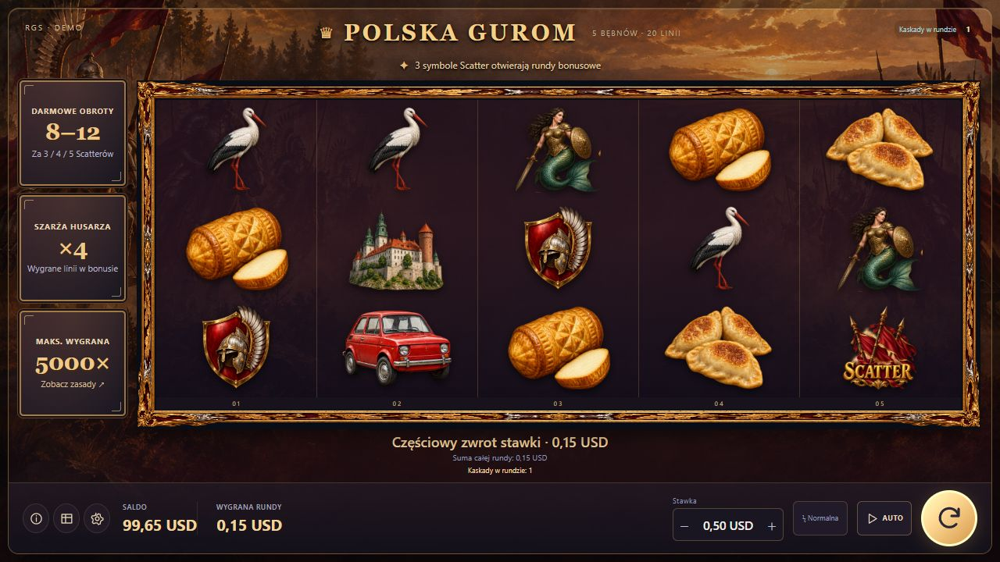

# POLSKA GUROM — integracja RGS i testy lokalne

Data: 21.10.2026. Matematyka: 0.5.0-any-start.

**Dodano klienta kontraktu Stake Engine i sprawdzono go lokalnie. Nie wykonano połączenia z rzeczywistym środowiskiem Stake.** Użytkownik potwierdził brak środowiska testowego i wybrał przygotowanie integracji oraz testów lokalnych. Ten raport uzupełnia poprzedni audyt, nie zastępuje akceptacji platformy.

## Wykonane

- Czytanie parametrów sesji i hosta RGS z linku uruchomienia; HTTPS, limit czasu, bez tokenów w historii i zapisie odzyskiwania.
- Authenticate przed wywołaniami portfela; saldo, waluta, domyślna stawka, dopuszczalne poziomy, minimum, maksimum i krok z serwera.
- Jeden play w trybie `base` za całą rundę z kaskadami i bonusem. Nazwa trybu odpowiada manifestowi istniejącej matematyki.
- Prezentacja pełnego wyniku, następnie end-round wyłącznie dla aktywnej rundy. Zerowe zamknięte rundy nie wywołują zakończenia.
- Saldo z odpowiedzi serwera i okresowy balance podczas bezczynności. Ochrona przed nadpisaniem nowszego portfela starszą odpowiedzią.
- Kwoty w skali 1 000 000, całkowite obliczenia wypłat BigInt i formatowanie waluty, w tym JPY/KWD.
- Wznowienie aktywnej rundy po authenticate. Zachowanie postępu tej samej karty i wybranej stawki; AUTO nie startuje samo po błędzie.
- Brak automatycznego ponawiania niejednoznacznego play. Weryfikacja authenticate zamiast drugiego zakładu. Utracone potwierdzenie wypłaty również wymaga sprawdzenia stanu.
- Blokada lokalnego portfela, resetu i scenariuszy przy uruchomieniu RGS. Statyczna paczka platformowa wymaga sesji i nie wraca do demo.
- Zachowano tło husarii, wygląd i matematykę gry. Silnik, bank oraz wagi są bajtowo identyczne z audytem po naprawach.

## Dowody

| Kontrola | Wynik |
|---|---:|
| Dotychczasowe testy gry i napraw | 134/134 |
| Nowe testy klienta RGS i rzeczywistej logiki interfejsu | 60/60 |
| Nowe testy rzeczywistego HTTP z lokalnym symulatorem | 5/5 |
| Razem | **199/199** |
| Pełny bank przez walidator interfejsu, odpowiedzi demo | 100 049/100 049 |
| Pełny bank przez walidator interfejsu, testowe koperty RGS | 100 049/100 049 |
| Kontrole paczek, zgodności źródeł i izolowanego uruchomienia | 124/124 |
| Zmiany matematyki/serwera rozliczeń demo | brak |
| Test na prawdziwym środowisku Stake/ACP | **niewykonany — brak dostępu** |

Testy kopert RGS wykorzystują rzeczywiste zdarzenia z banku i sztuczny nagłówek portfela. Nie są przedstawiane jako odpowiedzi prawdziwego serwera platformy. Symulatory Node i Python używają prawdziwych pełnych rund; sprawdzają kontrakt i kolejność rozliczeń, nie losowanie RTP.

Testy obejmują utratę odpowiedzi po pobraniu stawki i po wypłacie, zerowe wyniki, 8/12 FS, maksimum, wadliwe kwoty i konfiguracje, obcy aktywny betID, uszkodzone kaskady, brak sesji, zakaz powrotu do demo, stare odpowiedzi portfela i wznowienie po czterech z dwunastu darmowych obrotów. HTTP sprawdzono oddzielnie od testów z przyspieszonym zegarem.

W prawdziwej przeglądarce na lokalnym symulatorze sprawdzono uwierzytelnienie, wybór stawek, pełną animację oraz saldo: **100,00 USD → pobranie 0,50 USD → wypłata 0,15 USD → 99,65 USD**. Sprawdzono też odświeżenie i widok 390×700. Są to testy przeglądarkowe, nie odbiór fizycznego telefonu.

Pliki dowodowe: `regression_summary.json`, `rgs_results.json`, `frontend_bank_validation.json`, `package_verification.json`, `portable_rgs_http_result.json`, `source_manifest.json`, `FINAL_STATUS.json` oraz dzienniki poszczególnych zestawów.

## Paczki

- [Lokalny tester RGS](../../test-interface-any-start/POLSKA_GUROM_RGS_TEST.zip): wypakuj do osobnego folderu i uruchom START_RGS_TEST.cmd. Saldo wyłącznie wirtualne; stała sesja testowa; nasłuch tylko 127.0.0.1. Symulator powtarza wybrany scenariusz, domyślnie middle.
- [Statyczny frontend RGS](../../test-interface-any-start/POLSKA_GUROM_RGS_FRONTEND.zip): interfejs do dalszej integracji z platformą. Nie zawiera symulatora ani lokalnego wyboru wyników. Matematyka wymaga oddzielnego uploadu.
- [Instrukcja integracji i ograniczenia](../../test-interface-any-start/README_RGS_PL.md).

Skróty finalnych paczek i ich liczby plików zapisano w `package_verification.json` i `FINAL_STATUS.json`. Archiwum lokalnego testera uruchomiono po wypakowaniu w izolacji od roboczego katalogu gry.

## Pozostałe ograniczenia

1. Brak realnego launchu, sesji, uploadu i odbioru Stake. Trzeba potwierdzić format `round.state`, betID/amount/active i obsługę bieżącego banku na platformie, a także hosting/CORS.
2. Gdy wynik play jest nieznany, a authenticate nie zwraca identyfikowalnej rundy, klient blokuje nowe zakłady. Nie zgaduje rozliczenia i nie wysyła play ponownie. Wyjaśnienie takich sytuacji z platformą nadal należy do pełnego recovery produkcyjnego.
3. End-round jest operacją sesyjną bez oczekiwanego betID w kontrakcie. Klient sprawdza tożsamość przez authenticate, ale nie stanowi to gwarancji serwera przy równoczesnej zmianie rundy z innej karty. Ten przypadek wymaga odbioru platformowego.
4. Zapis postępu na serwerze przez bet/event, replay, social, docelowe komunikaty platformy, audio, fizyczne urządzenia i ACP pozostają osobnymi pracami. Uruchomienia replay/social w kliencie RGS są blokowane.

Źródła kontraktu: [oficjalny klient — typy](https://github.com/engineio/ts-client/blob/main/src/types.ts), [authenticate](https://github.com/engineio/docs/blob/main/src/routes/docs/api/authenticate/%2Bpage.svx), [play](https://github.com/engineio/docs/blob/main/src/routes/docs/api/play/%2Bpage.svx), [end-round](https://github.com/engineio/docs/blob/main/src/routes/docs/api/end-round/%2Bpage.svx). Odczyt 21.10.2026.

## Podgląd lokalnego połączenia

